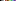

# Palette Quantization Post Processing (URP)

A Commodore 64-inspired **custom palette quantization effect** for **Unity 6 / Universal Render Pipeline (URP)** using **Render Graph**. Assign a palette strip containing **2 to 256 colors** (horizontal or vertical). Every camera pixel is mapped to its closest palette color, with optional ordered dithering, pixelation, and Volume-controlled color adjustments. If no palette is assigned, the bundled C64 16-color palette is used.



## Install with Unity Package Manager

1. Open **Window > Package Manager** in Unity.
2. Click **+ > Install package from git URL...** (or **Add package from git URL...**, depending on Unity version).
3. Paste this URL:

   ```text
   https://github.com/unitycoder/c64paletteforunity.git
   ```

4. Click **Install** (or **Add**).

**Git install URL:** https://github.com/unitycoder/c64paletteforunity.git

The URL works **after this repository has been published** under the `unitycoder` GitHub account with the repository name `c64paletteforunity`. If you publish it under another account or name, update the URL above and the URLs in `package.json`.

To pin a specific tagged release (once you create the tag `v1.1.0`), use:

```text
https://github.com/unitycoder/c64paletteforunity.git#v1.1.0
```

Alternatively, clone/download the repo and use **+ > Add package from disk...** pointing to the repository-root `package.json`.

You can also add the following entry to your Unity project's `Packages/manifest.json` dependencies:

```json
"c64paletteforunity": "https://github.com/unitycoder/c64paletteforunity.git"
```

### Requirements

- Unity **6000.0** or newer, with URP **17.0.0** or newer.
- **Render Graph** enabled (Compatibility Mode disabled).
- Git installed and available on `PATH` to use the Git URL installation option.

## Set up the effect

1. In your URP Renderer Data asset, add **C64 Palette Renderer Feature**.
2. Create a Global Volume (or use an existing Volume and Volume Profile).
3. Choose **Add Override > Post-processing > C64 Palette**.
4. Check the override checkbox for **Enabled**, then enable it.
5. Optionally override the palette texture and individual sliders.

The feature ships with `Runtime/Resources/C64Palette16.png` (16 x 1). It also generates the same 16-color palette in memory as the fallback, so you do not need to assign a texture to start using the effect.

To use your own PNG, assign it to the **Palette** Volume override and check that parameter's override checkbox. **The number of colors is detected automatically** from the actual imported texture dimensions; you do not need to set a count manually.

Supported palette dimensions include:

| Size | Colors | Orientation |
| --- | ---: | --- |
| `2 x 1` | 2 | Horizontal |
| `4 x 1` | 4 | Horizontal |
| `16 x 1` | 16 | Horizontal |
| `32 x 1` | 32 | Horizontal |
| `64 x 1` | 64 | Horizontal |
| `256 x 1` | 256 | Horizontal |
| `1 x 256` | 256 | Vertical |

Any color count **2 through 256** is valid, not just powers of two. The colors must occupy **one row or one column**: a `16 x 16` palette grid will not work without flattening it into a strip. The effect ignores alpha in the palette entries. Unsupported texture sizes cause a warning and the built-in C64 palette is used instead.

## Volume options

| Setting | Default | Description |
| --- | --- | --- |
| Enabled | Off | Turn on the Volume override and toggle it on. |
| Palette | Built-in C64 | Optional 2-256 color strip PNG; default is 16-color C64. |
| Intensity | 1 | Original camera image (0) to full palette quantization (1). |
| Brightness | 0 | Pre-quantization brightness offset. |
| Contrast | 1 | Pre-quantization contrast. |
| Saturation | 1 | Pre-quantization saturation. |
| Color Weighting | 1 | 0 = RGB distance; 1 = weighted RGB distance. |
| Dithering | 0 | 4 x 4 ordered Bayer dithering amount. |
| Dither Scale | 1 | Screen-pixel size of dither cells. |
| Pixel Size | 1 | Screen-pixel size for optional pixelation. |

For clean 16-color output, use **Intensity = 1**, **Dithering = 0**, and **Pixel Size = 1**. For a more stylized look, try **Dithering = 0.5** and **Pixel Size = 2**.

## Palette PNG import settings

The included PNG is located at `Runtime/Resources/C64Palette16.png`. The tracked `.meta` file is configured for exact-color import.

For a custom palette strip PNG, use:

- Texture Type: **Default**
- Width x height: **N x 1** or **1 x N**, where N is between 2 and 256
- **sRGB (Color Texture): Off** (recommended for speed; On is also supported)
- **Compression: None** (including platform overrides)
- **Mip Maps: Off**
- **Non-Power of 2: None**
- **Filter Mode: Point** and **Wrap Mode: Clamp**
- **Read/Write Enabled: Off** (not needed)

The shader uses integer texel loads for palette entries, rather than filtering between palette colors. Disable **Non-Power of 2 scaling**: Unity must not resize e.g. a 63-color strip to 64 pixels.

**Why sRGB Off?** A palette PNG normally stores 8-bit display/sRGB color values. With `sRGB (Color Texture)` **Off**, the shader can compare them directly in sRGB space, and converts only the final chosen color to linear for output (when the project uses Linear color space). With **On**, Unity's GPU decodes palette texture values to linear and the shader converts each candidate back to sRGB for comparison, which is slower for large palettes. Both modes preserve the palette colors correctly.

## Technical notes

- Applies after the standard URP post-processing stage (good for SDR/tone-mapped input).
- Supports URP Forward and Deferred renderers.
- Uses a single fullscreen pass with an **exact nearest-color search** across all N palette entries (2-256) for every output pixel.
- Skips preview/reflection and overlay cameras. Screen Space - Overlay UI is not affected.
- **Performance:** 256-color palettes require up to 256 palette lookups and distance comparisons **per output pixel**. They can be significantly more demanding than 16-color palettes, particularly in VR and at high resolutions. The Pixel Size slider stylizes the image but does **not** reduce the number of fullscreen shader invocations. For performance-critical applications, a precomputed 3D color lookup texture is an optional future optimization, with a possible accuracy tradeoff.
- Built for Render Graph; the legacy Compatibility Mode path is not implemented.
- Uses URP's XR-aware blit shader helpers; headset output has not been independently verified.
- For HDR output, dynamic resolution, and multiple stacked cameras, test on your target platform.
- If the effect is missing, check that the Renderer Feature is on the active Renderer Data, the camera's Volume Mask includes the Volume layer, and the `Enabled` override is checked.

## Repository layout

```text
package.json
README.md
CHANGELOG.md
LICENSE
Runtime/
    UnityCoder.C64Palette.asmdef
    C64PaletteRendererFeature.cs
    C64PaletteVolume.cs
    Resources/
        C64Palette16.png
        C64PaletteQuantize.shader
.github/workflows/validate.yml
```

Commit the `.meta` files along with the source assets to preserve Unity asset GUIDs. You can add this directory directly as a **new GitHub repository**; `package.json` must stay at the root for the Git URL above to work.

## Credits and license

Bundled default colors are based on the 16-color [Commodore 64 palette on Lospec](https://lospec.com/palette-list/commodore64).

Source code is provided under the [MIT license](LICENSE).
